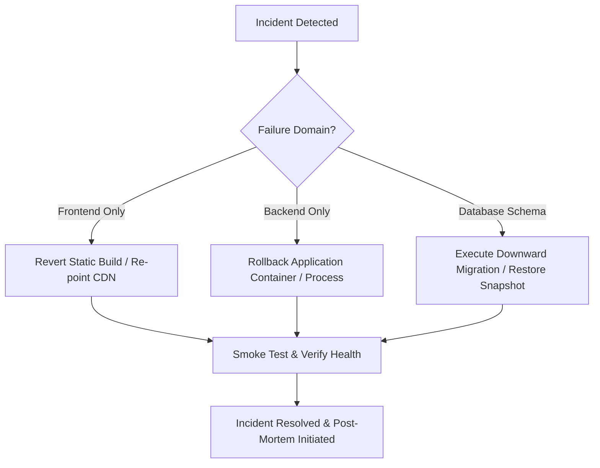

# FoodSafe AI — Production Rollback & Release Recovery Plan
**Platform:** FoodSafe AI (React 19 + Vite 8.2 Frontend, Express 5.x Backend, MySQL 8.0)  
**Classification:** Operational Runbook & Disaster Recovery Protocol  
**Version:** 1.0.0 (Phase 3 Production Audit)

---

## 1. Rollback Decision Framework

A rollback must be initiated immediately if any of the following critical thresholds are met during the first 60 minutes of release:

| Trigger Condition | Threshold | Action Owner |
| :--- | :---: | :--- |
| **Liveness / Readiness Probe Failure** | `/health` or `/ready` 503 for > 90 seconds | DevOps / SRE Lead |
| **HTTP 5xx Server Error Spike** | > 2% of total API transactions | Backend Lead |
| **Authentication System Failure** | Inability to log in across Customer, Admin, or Authority | Security Lead |
| **Database Connection Starvation** | Connection pool timeout (`DB_POOL_ACQUIRE`) > 5 occurrences | DBA / SRE |
| **Frontend Fatal Rendering Crash** | White screen / uncaught JavaScript exception blocking root or dashboards | Frontend Lead |

---

## 2. Emergency Rollback Runbook (Step-by-Step)



### Phase 2.1: Frontend Rollback
Since the frontend is a compiled Single Page Application (SPA), frontend rollback does not touch database state:
1. **Container / Static Server (Nginx / Cloudflare Pages / Vercel):**
   - Promote previous green build artifact:
     ```bash
     # Example: Revert symbolic link to previous known-good release
     ln -sfn /var/www/foodsafe-frontend/releases/v1.0.0-previous /var/www/foodsafe-frontend/current
     nginx -s reload
     ```
2. **Local Preview / Node Service:**
   - Swap `frontend/dist` directory with the pre-deployment backup copy.
3. **Verification:**
   - Run `curl -I https://<FRONTEND_DOMAIN>/` and verify HTTP 200.
   - Verify cache invalidation across CDN nodes.

### Phase 2.2: Backend Rollback
1. **Process Management (PM2 / Systemd / Docker):**
   - **Docker / Kubernetes:**
     ```bash
     # Rollback to previous container image tag
     docker-compose pull backend-previous
     docker-compose up -d --no-deps backend
     ```
   - **Systemd Service:**
     ```bash
     git checkout <LAST_KNOWN_STABLE_TAG_OR_COMMIT>
     npm ci --production
     sudo systemctl restart foodsafe-backend
     ```
2. **Health Verification:**
   ```bash
   curl -s http://localhost:5000/health | grep '"status":"UP"'
   curl -s http://localhost:5000/ready | grep '"status":"READY"'
   ```

### Phase 2.3: Database Rollback Protocol

> [!CAUTION]
> Irreversible Changes Notice: Dropping columns or truncating tables causes permanent data loss. If a database change modified or deleted records, a snapshot restoration is required.

#### Scenario A: Non-Destructive Schema Change (New Table or Index Added)
New tables and indexes (such as `idx_complaints_status`) are backwards-compatible and do NOT require immediate reversal during an application rollback. They can remain in place while the backend application code is rolled back.

#### Scenario B: Schema Change Requires Downward Migration
If an incompatible column alteration occurred:
1. Switch application to Maintenance Mode (`HTTP 503` maintenance banner).
2. Execute the corresponding reverse SQL migration:
   ```sql
   -- Example: Drop incompatible column or constraint
   ALTER TABLE complaints DROP COLUMN new_incompatible_column;
   ```
3. Restart backend service.

#### Scenario C: Catastrophic Database Corruption
If transactional data was corrupted during deployment:
1. Put application into Maintenance Mode.
2. Terminate all active backend connections:
   ```bash
   sudo systemctl stop foodsafe-backend
   ```
3. Restore the pre-deployment database backup created immediately prior to release:
   ```bash
   mysql -h localhost -u root -p smart_food_safety < /backups/emergency_pre_deployment_snapshot.sql
   ```
4. Verify row counts matching the pre-deployment baseline.
5. Restart backend service and disable Maintenance Mode.

---

## 3. Preserving Uploaded Evidence Files During Rollback

The platform stores uploaded evidence files on persistent storage (`backend/uploads/`).
- **Safety Rule:** Rollbacks must NEVER touch the `uploads/` directory.
- Files stored on disk use cryptographically secure UUID filenames (`<UUID>.jpg`, `<UUID>.png`).
- Reverting backend code preserves all existing disk files without deletion.

---

## 4. Post-Rollback Validation Matrix

Following any rollback execution, verify the three core user roles before reopening the platform to the public:

| Verification Check | Target URL | Expected Response |
| :--- | :--- | :--- |
| **System Liveness** | `GET /health` | HTTP 200, `{"status":"UP"}` |
| **Database Readiness** | `GET /ready` | HTTP 200, `{"status":"READY","database":"CONNECTED"}` |
| **Citizen Grievance Submission** | `POST /api/complaints` | HTTP 201, `{"success":true,"complaint_id":"FSA-..."}` |
| **Complaint Tracking** | `GET /api/complaints/:id` | HTTP 200, status payload returned |
| **Admin Moderation** | `GET /api/admin/complaints` | HTTP 200, complaints roster returned |
| **Authority Enforcement** | `GET /api/authority/complaints` | HTTP 200, verified complaints queue returned |

---

## 5. Post-Mortem & Incident Review

Within 24 hours of any rollback:
1. Export server logs: `/var/log/foodsafe-backend.log`.
2. Document root cause: code defect, environment configuration, database lock, or external dependency failure.
3. Formulate preventive regression test in `backend/test_phase1_comprehensive.js` or `run_phase2_qa.js`.
4. Ensure fix passes the full regression suite before rescheduling deployment.
